# ATmega128 POV Display — 회전 LED 잔상 디스플레이

> 마이크로프로세서 수업 Term Project · **2025.08 – 2025.11** · 4인 팀 (팀장) — 회로·PCB·펌웨어·기구 설계 담당 (기여도 90%)

세로 한 줄로 배치한 **RGB LED 16개**를 모터로 회전시키고, 회전에 맞춰 열(column) 데이터를 바꿔 **잔상(POV)으로 글자와 그림을 그리는** 디스플레이입니다.
ATmega128의 GPIO · 외부 인터럽트 · 타이머 PWM을 사용했고, **74HC595 6개 데이지 체인으로 LED 48채널을 MCU 핀 3개로 구동**하는 LED 보드를 KiCad로 설계·제작했습니다.

<p align="center">
  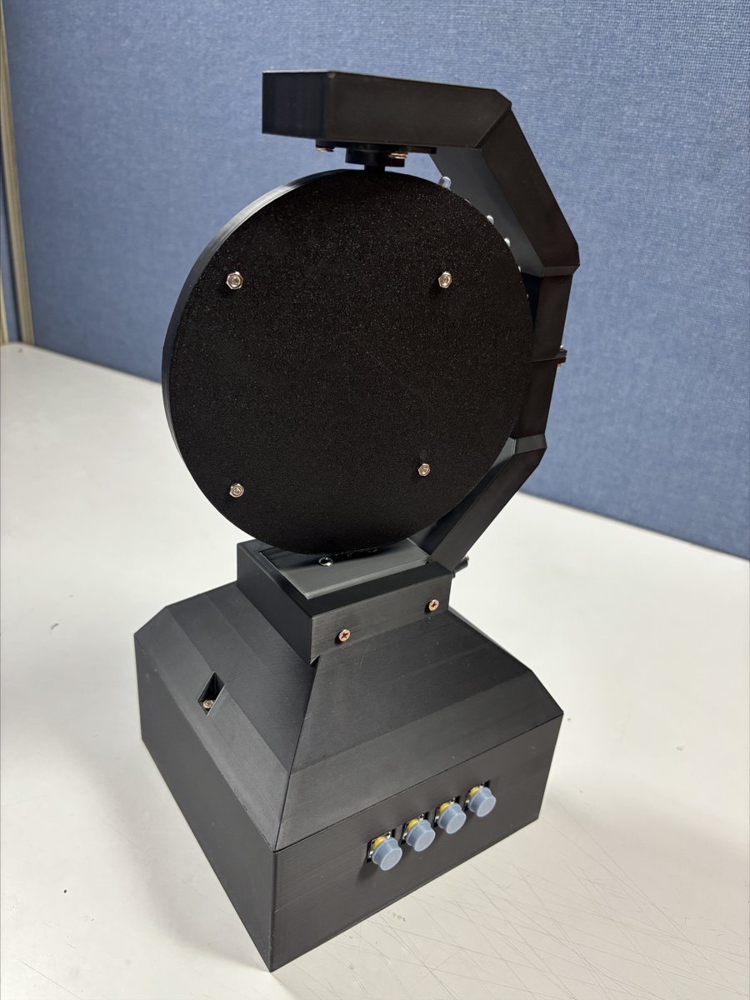
  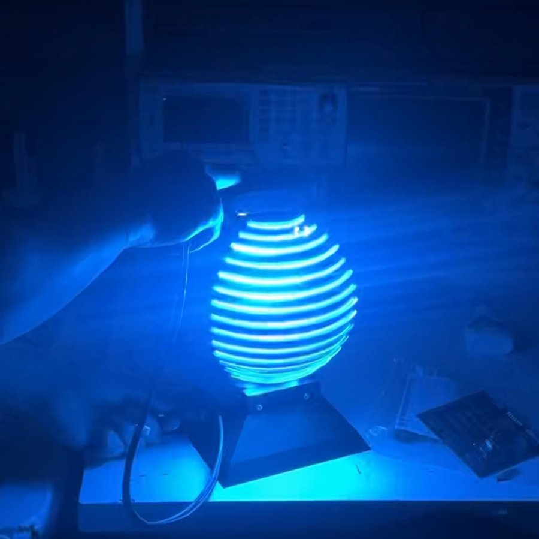
  <br><sub>왼쪽 완성품 · 오른쪽 회전 중 잔상 — LED 한 줄이 회전하며 구(球) 형태의 면을 만듦</sub>
</p>

| 항목 | 내용 |
|---|---|
| MCU | ATmega128 × 2 (LED 보드 / 모터 보드) |
| LED | RGB LED 16개 (16행 × R·G·B = 48채널), Active-Low 구동 |
| LED 드라이버 | 74HC595 × 6 데이지 체인 (48비트 직렬 → 래치 1회) |
| 모터 | DC 모터 + L298N, Timer0 Fast PWM 속도 제어 |
| 입력 | 택트 스위치 → 외부 인터럽트 INT0~3 (LED 보드 4개, 모터 보드 3개) |
| 기능 | 6색 · 6단계 밝기(듀티 1/7 ~ 6/7) · 패턴 2종(글자 `ISA` / 하트) · 모터 속도 ± · 일시정지 |
| 개발 환경 | CodeVisionAVR (C), KiCad 9, Fusion 360 |
| 상태 | 완료 (수업 종료 후 추가 개발 없음) |

---

## 1. Project Overview

- **목적**: 적은 수의 LED로 2차원 이미지를 표시하는 회전형 POV 디스플레이 제작
- **배경**: LED 16개는 그 자체로는 세로 선 하나지만, 회전시키면서 정확한 타이밍에 빛을 바꾸면 잔상 효과로 선이 지나간 자리가 면이 됩니다. 부품 수 대신 **시간으로 해상도를 만든다**는 점에 끌려 주제로 골랐습니다.
- **해결하려 한 문제**
  - 단색 8행 → RGB 16행으로 바꾸면서 필요한 출력 핀이 8개 → 48개로 늘어남
  - 회전체 위에 MCU·드라이버·LED를 싣기 위한 소형 단일 보드 필요 (이전 프로젝트의 만능기판 배선 한계)
  - 회전부와 고정부 사이에 전원만 넘길 수 있는 슬립링 제약

### 담당 범위

| 파트 | 내용 |
|---|---|
| 회로 / PCB | LED 보드 회로도 설계, PCB 아트웍, Gerber 출력 및 제작 |
| 펌웨어 | LED 보드(시프트 레지스터 구동, 색상·밝기·패턴 제어), 모터 보드(PWM 속도 제어) |
| 기구 | 회전판, 덮개, 지지대, 받침대 3D 모델링 및 출력 |
| 설계 문서 | 블록 다이어그램, 제어 플로우차트, 핀 배치 |

---

## 2. System Architecture

<p align="center">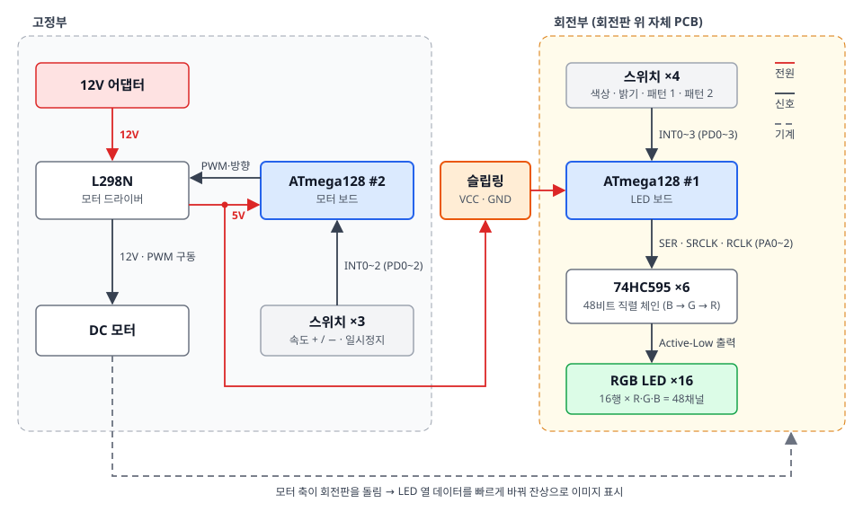</p>

| 구성 | 위치 | 역할 |
|---|---|---|
| 12 V 어댑터 → L298N | 고정부 | 모터 구동, L298N의 5 V 출력으로 모터 보드와 회전부에 전원 공급 |
| 모터 보드 (ATmega128 #2) | 고정부 | 버튼 인터럽트로 PWM 듀티 변경 → L298N ENA |
| 슬립링 | 고정부 ↔ 회전부 | 회전하는 LED 보드에 VCC · GND만 전달 |
| LED 보드 (ATmega128 #1) | 회전부 | 74HC595 체인으로 48채널 출력, 버튼으로 색·밝기·패턴 선택 |

두 MCU 사이에는 통신이 없습니다. 모터 속도와 LED 출력 타이밍은 각각 독립적으로 동작합니다.

<p align="center">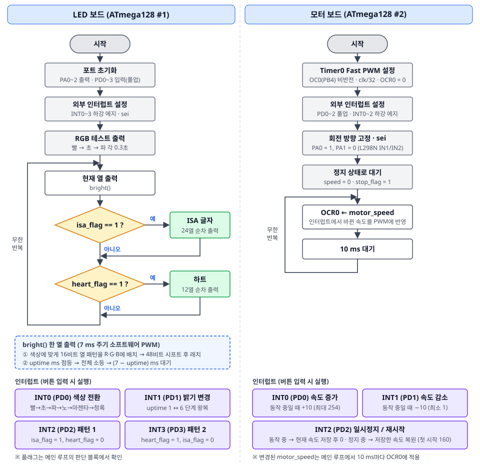</p>

---

## 3. Hardware Design

### LED 보드 PCB

- **크기**: 90.3 × 87.2 mm, 2층, 두께 1.6 mm (KiCad 9)
- **구성**
  - ATmega128-16A (TQFP-64) + 크리스털, 22 pF 부하 커패시터, 리셋 스위치
  - 74HC595 × 6 (R·G·B 각 2개, 색당 16비트) + 칩별 0.1 µF 바이패스 커패시터
  - 8연 저항 네트워크(R_Network08) × 2
  - LED 연결 패드 48개 (R/G/B × 16), 10핀 ISP 헤더 (PE0 / PE1 / PB1 / RESET)
  - 고정용 마운팅 홀 4개
- 48채널 LED 배선을 회전체에 싣기 위해 MCU와 시프트 레지스터를 한 장의 보드로 통합
- 브레드보드 테스트를 거친 뒤 PCB로 제작 ([브레드보드 사진](docs/images/breadboard.jpg))

| PCB 레이아웃 | PCB 3D 뷰 | 회전판 조립 (LED 48채널 배선) |
|:---:|:---:|:---:|
| 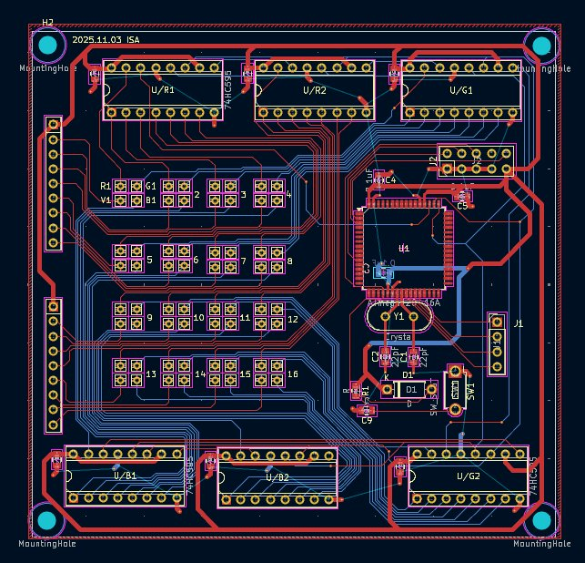 | 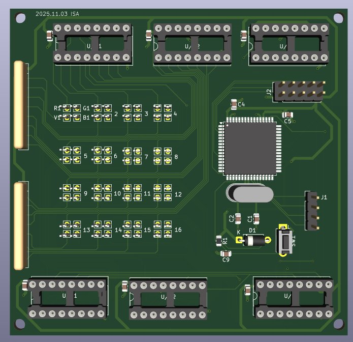 | 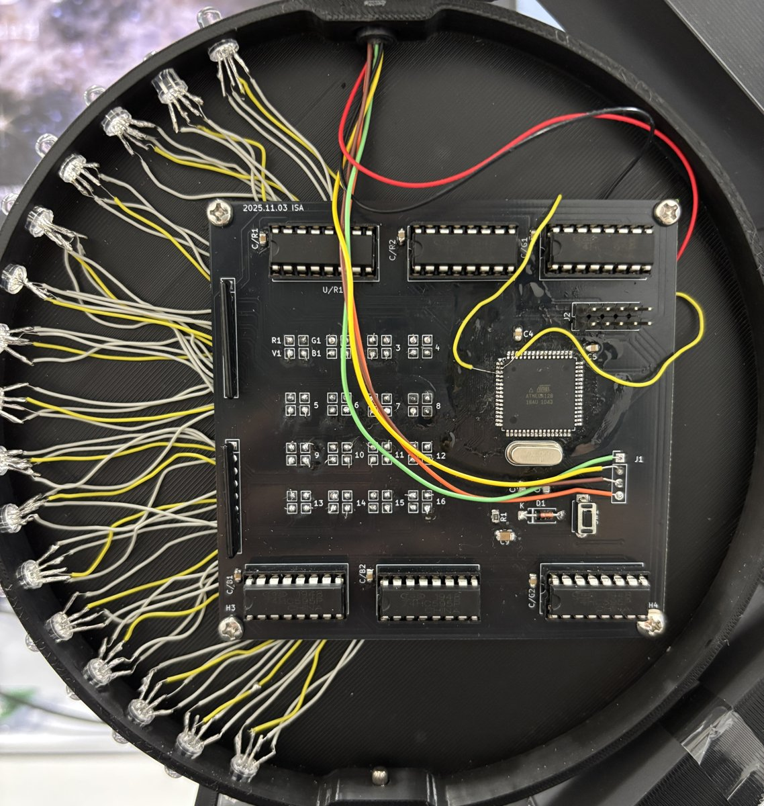 |

### 핀 배치

**LED 보드 (ATmega128 #1)**

| 핀 | 방향 | 용도 |
|---|---|---|
| PA0 | 출력 | 74HC595 SER / DS (직렬 데이터) |
| PA1 | 출력 | 74HC595 SRCLK / SHCP (시프트 클럭) |
| PA2 | 출력 | 74HC595 RCLK / STCP (래치 클럭) |
| PD0 (INT0) | 입력, 풀업 | 색상 전환 (빨 → 초 → 파 → 노 → 마젠타 → 청록) |
| PD1 (INT1) | 입력, 풀업 | 밝기 변경 (단계 왕복) |
| PD2 (INT2) | 입력, 풀업 | 패턴 1: `ISA` 글자 |
| PD3 (INT3) | 입력, 풀업 | 패턴 2: 하트 |

**모터 보드 (ATmega128 #2)**

| 핀 | 방향 | 용도 |
|---|---|---|
| PB4 (OC0) | 출력 | PWM → L298N ENA |
| PA0 / PA1 | 출력 | L298N IN1 / IN2 (회전 방향 고정) |
| PD0 (INT0) | 입력, 풀업 | 속도 +10 (최대 254) |
| PD1 (INT1) | 입력, 풀업 | 속도 −10 (최소 1) |
| PD2 (INT2) | 입력, 풀업 | 일시정지 / 재시작 (직전 속도 복원, 첫 시작 160) |

인터럽트는 모두 하강 에지 트리거(`EICRA`)이고, 풀업은 MCU 내부 풀업(`PORTD`)을 사용합니다.

### 기구부

- 회전판에 PCB와 LED를 고정하고 모터 축에 연결, 지지대(위/아래)와 받침대로 모터와 회전부를 고정
- 회전부 전원은 슬립링을 통해 공급

| 회전판 · 덮개 | 지지대 · 받침대 | 최종 조립 모델 |
|:---:|:---:|:---:|
| 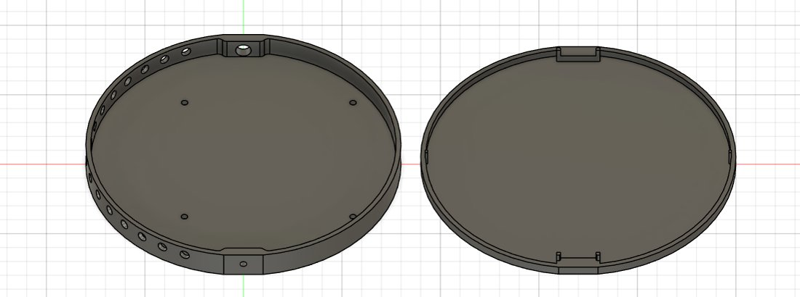 | 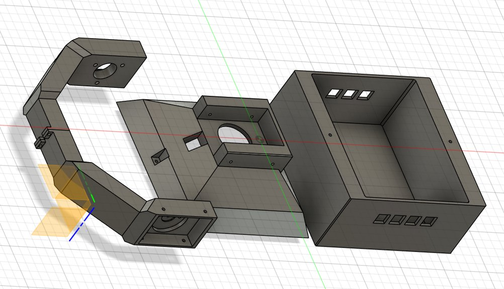 | 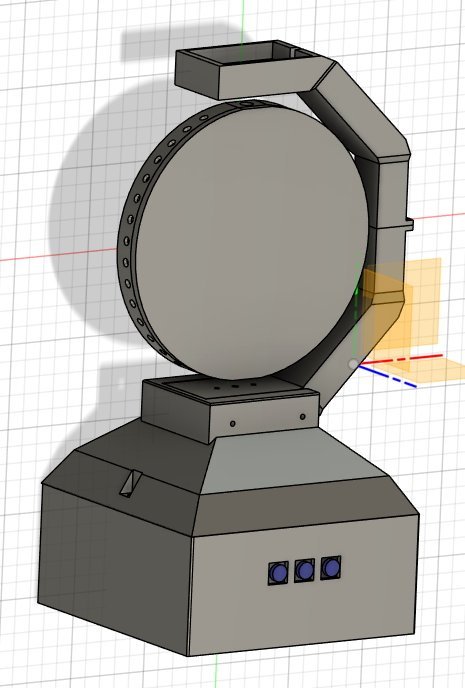 |

---

## 4. Firmware & Software

| 항목 | 내용 |
|---|---|
| 개발 환경 | CodeVisionAVR, ISP 프로그래머 |
| 언어 | C (`mega128.h`, `delay.h`: CodeVisionAVR 기본 헤더) |
| 사용 주변장치 | GPIO, 외부 인터럽트 INT0~3, Timer0 (모터 보드) |
| 파일 | [`firmware/led_board/main.c`](firmware/led_board/main.c) (216줄), [`firmware/motor_board/main.c`](firmware/motor_board/main.c) (81줄) |

### LED 보드 주요 함수

| 함수 | 역할 |
|---|---|
| `shift_16_bits()` | MSB부터 1비트씩 SER에 놓고 SRCLK 펄스 (GPIO 비트뱅잉) |
| `shiftOutRGB()` | B → G → R 순서로 16비트씩, 총 48비트를 밀어 넣은 뒤 RCLK 한 번으로 동시에 출력 |
| `update_led_colors()` | 현재 색 상태에 따라 열 패턴을 R/G/B 중 필요한 채널에 배치 (나머지는 `0xFFFF` = 소등) |
| `bright()` | 한 열을 `uptime` ms 켜고 `7 − uptime` ms 끄는 소프트웨어 PWM |
| INT0~3 ISR | 색 상태, 밝기 단계, 패턴 선택 플래그 변경 |

### 모터 보드

- Timer0 Fast PWM, 비반전 출력(`COM01`), 분주 `CS01|CS00`
- 버튼 ISR은 속도 변수만 바꾸고, 메인 루프가 10 ms마다 `OCR0`에 반영

---

## 5. Implementation

### 동작 원리

1. **LED 한 열 출력** — 16비트 열 패턴을 색상에 따라 R/G/B 채널에 배치하고, 48비트를 시프트한 뒤 RCLK로 한 번에 래치. 비트가 `0`이면 LED 켜짐(Active-Low), `0xFFFF`는 전체 소등
2. **밝기** — 한 열을 `uptime` ms 동안 켜고 `7 − uptime` ms 동안 꺼서, 7 ms 주기 안에서 듀티비를 바꿈
3. **패턴** — 열 데이터를 순서대로 바꿔 출력하면 회전 중 잔상으로 2차원 이미지가 보임. `ISA` 글자 24열(글자당 8열), 하트 12열
4. **모터 속도** — `OCR0` 값(0~254)을 인터럽트로 ±10씩 바꿔 L298N ENA에 입력

### 주요 설계 결정

- **시프트 레지스터 체인**: GPIO 48개 대신 3개. 남은 포트는 버튼 인터럽트와 ISP에 사용. 래치(RCLK)가 따로 있어 시프트 중간 상태가 LED에 보이지 않음
- **보드 2개 구성**: 슬립링이 전원선만 넘길 수 있어 모터 제어부(고정)와 디스플레이부(회전)를 MCU 2개로 분리 ([트러블슈팅 2](#2-mcu를-하나로-합치지-못한-문제-미해결))
- **인터럽트 기반 입력**: 버튼을 외부 인터럽트로 받아, `delay_ms()`로 열 타이밍을 만드는 메인 루프 도중에도 입력이 처리됨

### 구현하면서 고려한 점

- 한 열의 길이는 `bright()`의 7 ms + 열 사이 `delay_ms(1)` = **약 8 ms로 고정**이고, 밝기는 그 안에서 켜져 있는 시간만 바뀝니다. 그래서 밝기를 낮추면 회전 방향으로 열이 짧게 보이는 효과도 함께 생깁니다 (코드 구조상 동작).
- `ISA` 패턴 한 번은 24열 × 약 8 ms ≈ 192 ms입니다. 회전 위치를 감지하지 않으므로, 글자가 제자리에 보이려면 모터 속도를 버튼으로 맞춰야 합니다.

---

## 6. Troubleshooting

### 1. RGB · 16행으로 확장하자 GPIO가 부족해진 문제
- **배경**: 처음에는 단색 LED 8개(8행)로 설계했으나, 여러 색 표현과 해상도 향상을 위해 RGB LED 16행으로 변경
- **문제**: RGB LED 16개를 GPIO로 직접 제어하면 16행 × 3색 = **48핀**이 필요 → ATmega128 포트 대부분을 LED에만 써야 해서 버튼 인터럽트 등에 쓸 핀이 부족
- **해결**: 74HC595 6개를 직렬로 연결해 48비트를 직렬로 전송하고 래치로 한 번에 출력 → MCU 핀 **3개**(PA0~2)로 48채널 제어
- **결과**: 단색 8행 → RGB 16행(6색)으로 확장하면서 LED 제어용 GPIO는 48개 → 3개

### 2. MCU를 하나로 합치지 못한 문제 (미해결)
- **상황**: 기능만 보면 ATmega128 하나로 LED 표시와 모터 PWM 제어를 모두 처리할 수 있음
- **원인**: LED 보드는 회전판 위, L298N·모터는 고정부에 있음. MCU를 하나로 합치면 모터 제어선(PWM, IN1·IN2)이나 버튼 신호도 슬립링을 거쳐야 하는데, 사용한 **슬립링의 선 수가 부족**
- **대응**: 모터 제어부(고정)와 디스플레이부(회전)로 나누어 ATmega128을 각각 사용
- **개선 방향**: 선 수가 더 많은 슬립링, 또는 회전부 MCU가 모터와 무관하게 동작하도록 회전 위치 센서를 회전부에 두는 방식

---

## 7. Performance & Validation

| 항목 | 방법 | 결과 |
|---|---|---|
| LED 48채널 개별 출력 | 정지 상태에서 R / G / B 전체 점등 (전원 투입 시 자가 점검 루틴) | 3색 모두 16행 점등 확인 (아래 사진) |
| 잔상 글자 표시 | 회전 중 촬영 | `I`, `S`, `A` 글자 확인 |
| 패턴 · 색 · 속도 조작 | 동작 영상 | 버튼으로 패턴 출력 확인 |

| Red | Green | Blue |
|:---:|:---:|:---:|
| 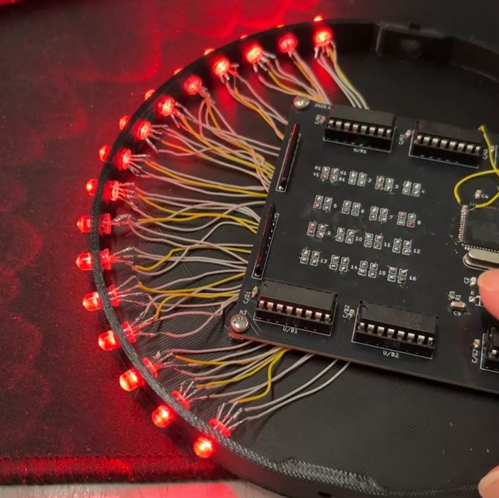 | 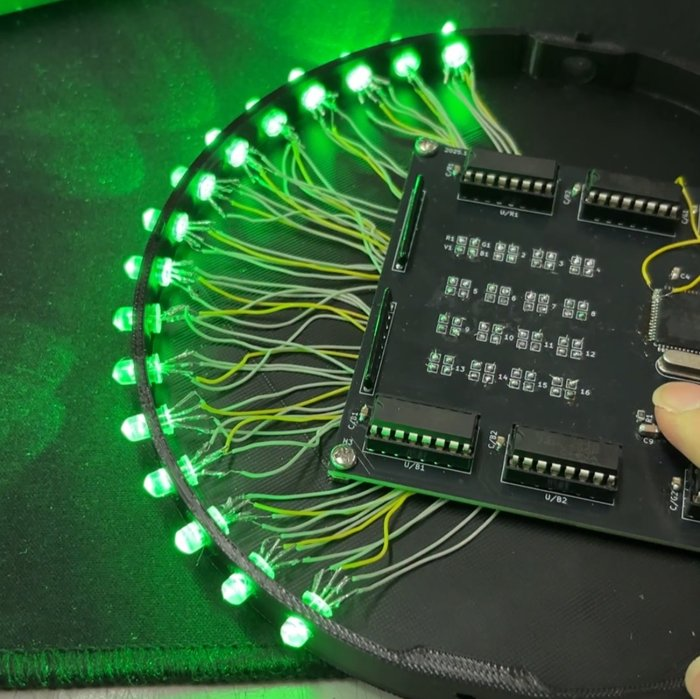 | 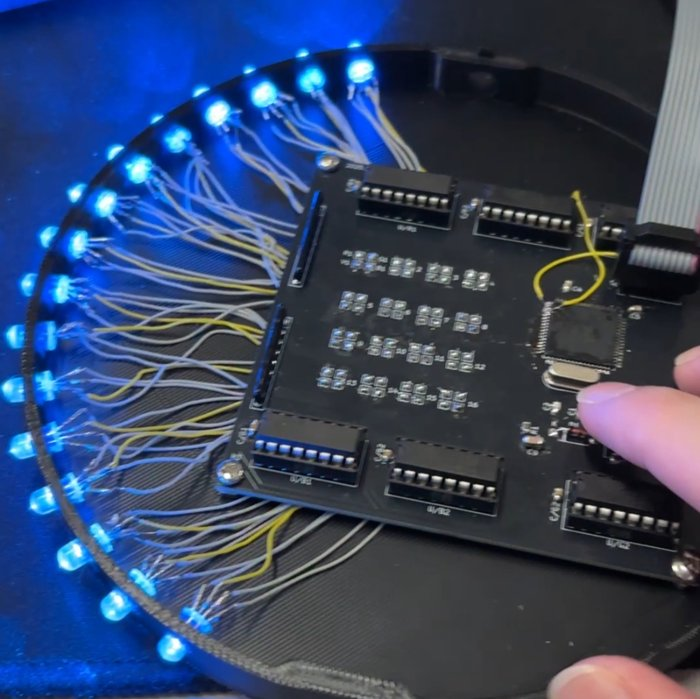 |

| I | S | A |
|:---:|:---:|:---:|
| 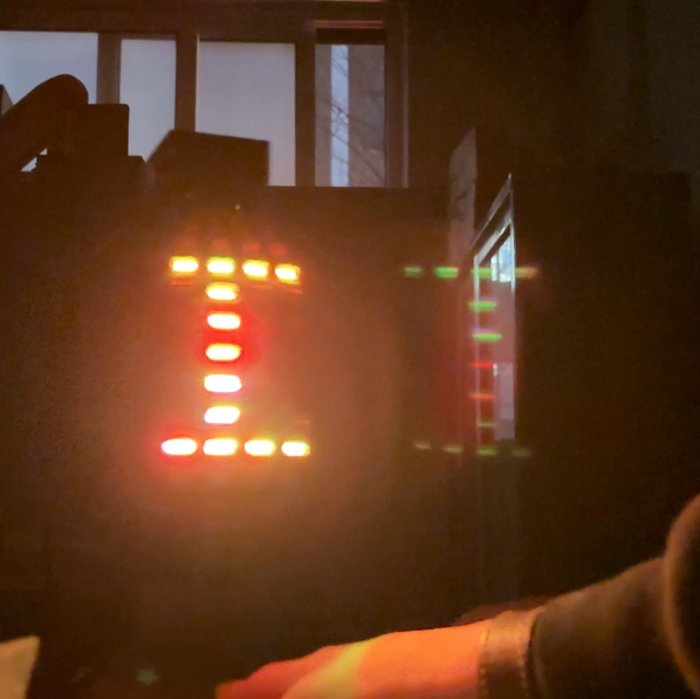 | 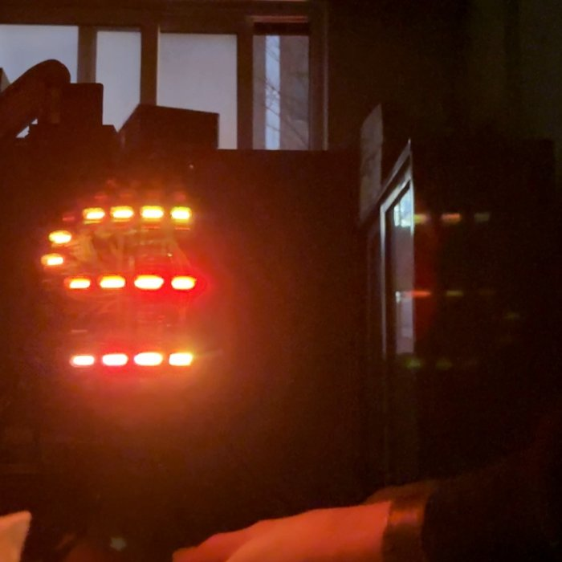 | 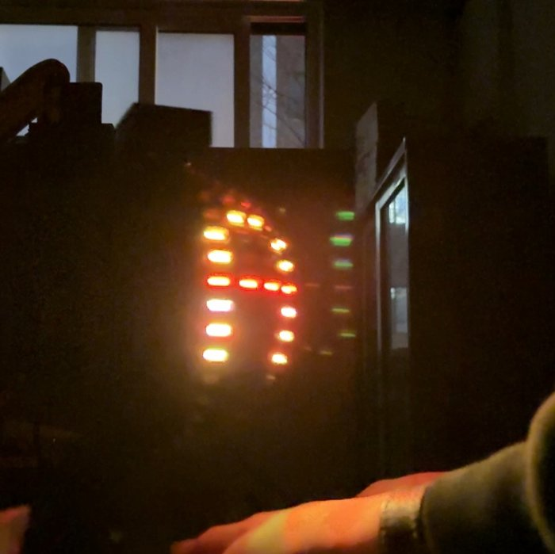 |

<a href="docs/videos/pattern_demo.mp4">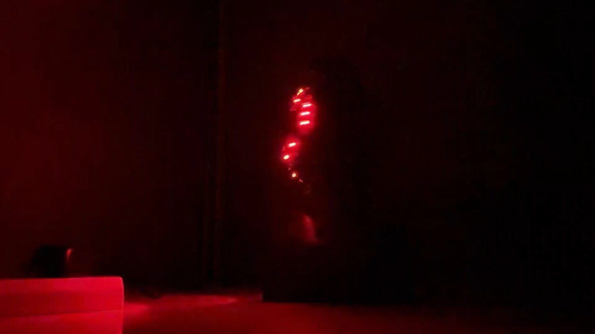</a>

▶ [`docs/videos/pattern_demo.mp4`](docs/videos/pattern_demo.mp4) — 회전하며 패턴을 출력하는 모습

**측정하지 않은 항목**: 회전 속도(RPM), PWM 주파수(크리스털 값에 따라 결정), 74HC595 시프트 1회 소요 시간, 소비 전류. 결과는 모두 사진·영상으로 확인한 정성적 결과입니다.

---

## 8. Limitations & Future Work

**현재 한계**
- **회전 동기화 없음**: 홀 센서나 포토 인터럽터 같은 기준 위치 신호가 없어, 패턴이 회전과 맞지 않으면 이미지가 흘러감. 모터 속도를 수동으로 맞춰야 함
- 열 타이밍을 `delay_ms()`로 만들어 해상도가 ms 단위이고, 메인 루프가 지연 동안 다른 일을 못 함
- 패턴이 코드에 직접 나열되어 있어 새 글자를 추가하려면 코드를 고쳐야 함
- 슬립링 선 수 제약으로 MCU 2개 사용
- 펌웨어 개선 여지: ISR에서 바꾸는 `isa_flag`·`heart_flag`가 `volatile`로 선언되어 있지 않음, 스위치 디바운스 없음

**개선 방향**
- 회전부에 홀 센서 + 고정 자석을 달아 한 바퀴 기준 신호를 외부 인터럽트로 받고, 측정한 회전 주기로 열 간격을 타이머로 계산
- 열 출력을 타이머 비교 인터럽트로 옮기고, SPI 하드웨어로 74HC595 시프트
- 패턴을 배열(폰트 테이블)로 분리

---

## 9. Repository Structure

```
atmega128-pov-display/
├─ firmware/                  CodeVisionAVR C 소스
│  ├─ led_board/main.c        74HC595 48비트 시프트 출력, 색상·밝기·패턴 제어
│  └─ motor_board/main.c      Timer0 Fast PWM 모터 속도 제어
├─ hardware/
│  └─ pcb/                    KiCad 9 프로젝트 (LED 보드)
│     ├─ MPMP.kicad_pro / .kicad_sch / .kicad_pcb
│     └─ gerber/              제작용 Gerber + 드릴 파일
├─ mechanical/                3D 프린팅 부품 (STL)
│  ├─ rotor_plate.stl         회전판 (PCB 장착)
│  ├─ rotor_cover_v2.stl      회전판 덮개
│  ├─ support_upper.stl       지지대 (위)
│  ├─ support_lower.stl       지지대 (아래)
│  ├─ base.stl                받침대
│  └─ base_support.stl        받침대 하부 받침
└─ docs/
   ├─ images/                 블록 다이어그램, 플로우차트, PCB · 3D · 결과 사진
   └─ videos/                 동작 영상
```

### 빌드 및 실행

1. CodeVisionAVR에서 새 프로젝트 생성 → Chip: **ATmega128**, 클럭은 보드 크리스털에 맞게 설정
2. LED 보드는 `firmware/led_board/main.c`, 모터 보드는 `firmware/motor_board/main.c`를 프로젝트에 추가
3. Build 후 ISP 프로그래머로 각 보드에 업로드

| 보드 | 스위치 | 동작 |
|---|---|---|
| 모터 | INT2 | 모터 시작 / 일시정지 (전원 투입 시 정지 상태) |
| 모터 | INT0 / INT1 | 속도 증가 / 감소 |
| LED | INT2 / INT3 | `ISA` 글자 / 하트 패턴 |
| LED | INT0 | 색상 전환 (6색) |
| LED | INT1 | 밝기 변경 |

LED 보드는 전원 투입 시 R → G → B를 0.3초씩 켜서 LED 상태를 확인한 뒤 대기합니다.

- PCB 제작: `hardware/pcb/gerber/` 폴더 전체를 압축해 PCB 제작 업체에 업로드
- 기구 출력: `mechanical/*.stl`을 슬라이서에서 열어 3D 프린터로 출력

---

## 기술 스택
`C (CodeVisionAVR)` `AVR ATmega128` · `74HC595` `L298N` · `KiCad 9` · `Fusion 360`

## 라이선스 / 출처
- [MIT License](LICENSE)
- 이 저장소의 코드, 회로 및 기구 설계는 모두 직접 작성했으며 외부 코드는 포함하지 않았습니다.
- `mega128.h`, `delay.h`: CodeVisionAVR 컴파일러 기본 헤더 (저장소에 미포함)
- PCB 회로도/풋프린트: KiCad 기본 라이브러리 심볼·풋프린트 사용 (CC-BY-SA 4.0, 설계물에 대한 예외 조항 적용)
